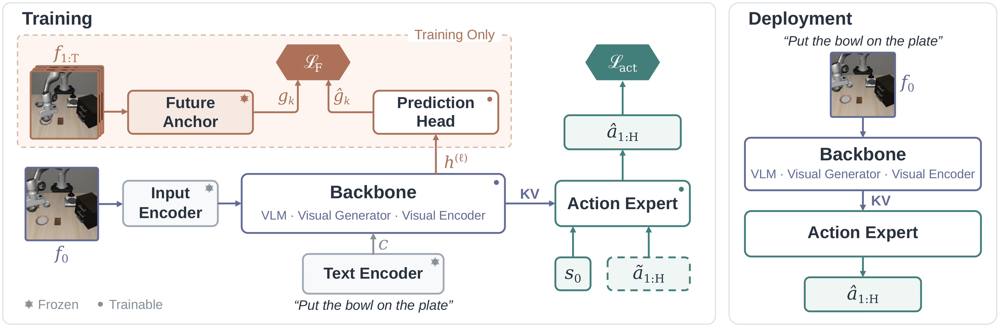

<div align="center">
  <h1>Just Action Models</h1>
  <h3>Vision-Language-Action or World-Action?</h3>
  <p>
    Yonghao Yu<sup>1</sup> &nbsp;·&nbsp;
    Lang Huang<sup>2,✉</sup> &nbsp;·&nbsp;
    Runyi Li<sup>1</sup> &nbsp;·&nbsp;
    Toshihiko Yamasaki<sup>1</sup>
  </p>
  <p><sup>1</sup>The University of Tokyo &nbsp;&nbsp; <sup>2</sup>National Institute of Informatics</p>
  <p>
    <a href="https://y0uroy.github.io/JAM/"></a>
    
    <a href="https://huggingface.co/y0urOy/JAM"></a>
    <a href="docs/INSTALL.md"></a>
  </p>
</div>

<p align="center">
  <b>Learn from the future. Act in the present.</b><br>
  Future observations supervise training. No image or video generation is needed.
</p>

The VLA–WAM debate over vision-language models versus visual generators bundles three choices: backbone
initialization, future supervision, and inference computation. **Just Action Models (JAM)** decouple them: a
pretrained backbone and action expert learn with action and foresight losses, predicting frozen features of recorded
futures through a head discarded after training. JAM uses no visual generation during training or inference, improves
matched FastWAM and ImageWAM baselines on LIBERO and LIBERO-Plus, and uses 73% fewer estimated online training FLOPs
than FastWAM with cached targets.

This repository contains the training and evaluation code for JAM on [LIBERO](https://github.com/Lifelong-Robot-Learning/LIBERO),
[LIBERO-Plus](https://github.com/sylvestf/LIBERO-plus) and [RoboTwin 2.0](https://github.com/RoboTwin-Platform/RoboTwin),
for five backbones: [Wan2.2](https://github.com/Wan-Video/Wan2.2), built on [FastWAM](https://github.com/yuantianyuan01/FastWAM),
and [Ovis-U1](https://github.com/ATH-MaaS/Ovis-U1), [FLUX.2](https://github.com/black-forest-labs/flux2),
[Qwen3.5-2B](https://huggingface.co/Qwen/Qwen3.5-2B-Base) and [DINOv2-B/L](https://github.com/facebookresearch/dinov2),
built on [ImageWAM](https://github.com/yuyangalin/ImageWAM).

<p align="center">
  
</p>

## Index

- [File Structure](#file-structure)
- [Environment Setup](#environment-setup)
- [Model Preparation](#model-preparation)
- [Dataset Download](#dataset-download)
- [Inference with Released Checkpoints](#inference-with-released-checkpoints)
- [Training](#training)
- [Inference with Your Trained Checkpoints](#inference-with-your-trained-checkpoints)
- [Acknowledgements](#acknowledgements)
- [License](#license)
- [BibTeX](#bibtex)

## File Structure

```text
JAM/
├── backends/
│   ├── wan/                  # JAM (Wan), built on FastWAM
│   └── multimodal/           # JAM (Ovis-U1, FLUX.2, Qwen3.5, DINOv2), built on ImageWAM
├── tools/
│   ├── jam.py                # Train, evaluate and summarize any named recipe
│   ├── bootstrap.py          # Create the pinned environment
│   ├── download_assets.py    # Base models and datasets at pinned revisions
│   ├── init_actions.py       # Build the action-expert initialization
│   └── setup_simulators.py   # LIBERO, LIBERO-Plus and RoboTwin simulator setup
├── environments/             # Pinned dependencies of the shared environment
├── reproduction/             # The ten JAM recipes, LIBERO-Plus task list, checkpoint manifest
├── third_party/RoboTwin/     # RoboTwin 2.0 evaluation code
├── docs/                     # Installation, data, training, evaluation
├── website/                  # Project page
└── tests/                    # CPU tests
```

## Environment Setup

All ten recipes use **one shared Python environment** for Wan, Ovis-U1, FLUX.2, Qwen3.5 and DINOv2.
Use Linux with Python 3.10 (including `venv`), an NVIDIA GPU and driver, the CUDA 12.8 toolkit (`nvcc`),
and a compatible C/C++ compiler.

**1. Clone the repository.**

```bash
git clone https://github.com/y0urOy/JAM.git
cd JAM
```

**2. Create the shared environment and install dependencies.**

```bash
python3.10 tools/bootstrap.py --venv .venv --libero
```

The installer creates `.venv` itself and installs PyTorch 2.7.1 with CUDA 12.8 support, both JAM backends,
the pinned dependencies, and the attention kernels. `--libero` also installs the LIBERO runtime libraries.

**3. Activate and verify the installation.**

```bash
source .venv/bin/activate
python -m pip check
python tools/jam.py list
```

`pip check` should report `No broken requirements found`, and `jam.py list` should show the ten recipes below.
Activate `.venv` again in each new terminal. Simulator checkouts and assets are prepared separately;
RoboTwin also needs its simulator packages installed into this same environment. Follow
[docs/INSTALL.md](docs/INSTALL.md) for compiler requirements and simulator setup.

### Recipes

| Policy | LIBERO recipe | RoboTwin 2.0 recipe |
|---|---|---|
| JAM (Wan) | `libero-wan-jam` | `robotwin-wan-jam` |
| JAM (Ovis-U1) | `libero-ovis-jam` | `robotwin-ovis-jam` |
| JAM (FLUX.2) | `libero-flux-jam` | `robotwin-flux-jam` |
| JAM (Qwen3.5-2B) | `libero-qwen-jam` | `robotwin-qwen-jam` |
| JAM (DINOv2-B / L) | `libero-dino-b-jam` / `libero-dino-l-jam` | |

## Model Preparation

Download the base models at their pinned revisions. They go to `artifacts/models/` unless `JAM_MODEL_ROOT` is set.

| Recipes | Assets |
|---|---|
| Wan | `wan`, `wan-tokenizer` |
| Ovis-U1 | `ovis` |
| Qwen3.5-2B | `qwen-2b` |
| DINOv2-B / L | `dino-b` / `dino-l`, `qwen3`, `ovis` |
| FLUX.2 | `flux`, `flux-ae`, `qwen3` |

```bash
python tools/download_assets.py wan
python tools/download_assets.py wan-tokenizer
```

`flux-ae` comes from the gated FLUX.2-dev repository (FLUX non-commercial license): accept its terms on Hugging Face
and log in (`HF_TOKEN` or the Hugging Face CLI) before downloading it.

Training also needs the action-expert initialization (DINOv2 and Qwen3.5 initialize from their own backbone):

```bash
python tools/init_actions.py wan                    # CUDA GPU
python tools/init_actions.py ovis --action-dim 7    # 14 for RoboTwin
python tools/init_actions.py flux --action-dim 7    # 14 for RoboTwin
```

## Dataset Download

JAM uses the LIBERO and RoboTwin 2.0 datasets preprocessed by FastWAM:

```bash
python tools/download_assets.py libero-data
python tools/download_assets.py robotwin-data
```

Extract the archives in place (`tar -xzf` each LIBERO archive; `cat robotwin2.0.tar.gz.part-* | tar -xzf -` for
RoboTwin). The expected layout is:

```text
artifacts/data/
├── libero_mujoco3.3.2/libero_{spatial,object,goal,10}_no_noops_lerobot/
└── robotwin2.0/
    ├── robotwin2.0/{data,meta,videos}/
    ├── robotwin2.0/nonidle_ranges.json
    └── dataset_stats.json
```

The Ovis-U1, Qwen3.5 and FLUX.2 RoboTwin recipes train on non-idle frames; build their frame ranges once:

```bash
python backends/multimodal/scripts/data/compute_robotwin_nonidle_ranges.py artifacts/data/robotwin2.0/robotwin2.0 \
  --output artifacts/data/robotwin2.0/robotwin2.0/nonidle_ranges.json
```

Prepare the simulators with `python tools/setup_simulators.py libero`, and with
`python tools/download_assets.py libero-plus-assets` followed by `python tools/setup_simulators.py plus`.
`third_party/RoboTwin/` holds the RoboTwin 2.0 evaluation code; install its simulator packages (SAPIEN 3.0.0b1) and
assets as described in [docs/INSTALL.md](docs/INSTALL.md).

## Inference with Released Checkpoints

The three LIBERO checkpoints are on [Hugging Face](https://huggingface.co/y0urOy/JAM), one folder per policy.
Their recorded results:

| Policy | Folder | LIBERO | LIBERO-Plus |
|---|---|---:|---:|
| JAM (Wan) | [`libero/wan`](https://huggingface.co/y0urOy/JAM/tree/main/libero/wan) | 98.15 | 64.54 |
| JAM (Ovis-U1) | [`libero/ovis-u1`](https://huggingface.co/y0urOy/JAM/tree/main/libero/ovis-u1) | 96.75 | 79.95 |
| JAM (Qwen3.5-2B) | [`libero/qwen3.5-2b`](https://huggingface.co/y0urOy/JAM/tree/main/libero/qwen3.5-2b) | 96.55 | 81.14 |

LIBERO: 40 tasks × 50 episodes. LIBERO-Plus: the fixed 1,506-task subset, one episode per task, task-weighted.

```bash
python -c "from huggingface_hub import snapshot_download; snapshot_download('y0urOy/JAM', allow_patterns='libero/wan/*', local_dir='checkpoints/jam_release')"
python checkpoints/jam_release/libero/wan/release.py verify
```

Each folder's `README.md` gives the commands that evaluate it with its recorded settings through `release.py eval`,
from a checkout of the JAM commit that the folder pins. The [checkpoint manifest](reproduction/libero_checkpoints.json)
lists their SHA256 checksums and inference settings.

## Training

`tools/jam.py` trains and evaluates the JAM recipes in [recipes.json](reproduction/recipes.json): `libero-wan-jam`, `libero-ovis-jam`,
`libero-qwen-jam`, `libero-dino-b-jam`, `libero-dino-l-jam` and `libero-flux-jam` on LIBERO, and `robotwin-wan-jam`, `robotwin-ovis-jam`,
`robotwin-flux-jam` and `robotwin-qwen-jam` on RoboTwin 2.0.

```bash
python tools/jam.py list
python tools/jam.py text-cache libero-wan-jam    # instruction cache (Wan, FLUX.2 and DINOv2 recipes)
python tools/jam.py train-eval libero-wan-jam --venv .venv \
  --gpus-per-node 8 --gpus 0,1 --benchmarks libero plus \
  --output artifacts/runs/libero-wan-jam
python tools/jam.py train-eval robotwin-wan-jam --venv .venv \
  --nodes 8 --gpus-per-node 8 --node-rank 0 --master-addr HOST0 --benchmarks robotwin \
  --output artifacts/runs/robotwin-wan-jam
```

`train-eval` trains one model, then evaluates its final checkpoint, and stops on any failure. The launcher keeps the recipe's
global batch on any GPU layout that divides it (`--micro-batch` fits memory, `--nodes`/`--node-rank`/`--master-addr`
run multi-node), and `--dry-run` prints the plan without running it. See [docs/TRAINING.md](docs/TRAINING.md) for
training budgets and [docs/DATA_AND_MODELS.md](docs/DATA_AND_MODELS.md) for the instruction caches and the optional
Wan foresight-target cache.

## Inference with Your Trained Checkpoints

A run directory remembers its recipe, overrides and normalization statistics:

```bash
python tools/jam.py eval --run-dir artifacts/runs/libero-wan-jam --venv .venv --benchmark libero --gpus 0,1
python tools/jam.py eval --run-dir artifacts/runs/libero-wan-jam --venv .venv --benchmark plus --gpus 0,1
python tools/jam.py eval --run-dir artifacts/runs/robotwin-wan-jam --venv .venv --benchmark robotwin --gpus 0
```

LIBERO and LIBERO-Plus results are written as `summary.json`, `summary.csv` and per-episode `episodes.csv`. RoboTwin
2.0 uses 50 tasks × 100 episodes in Clean and Randomized settings and writes its own `summary.json` and `summary.csv`.
See [docs/EVALUATION.md](docs/EVALUATION.md) for the protocols.

## Acknowledgements

JAM builds on [FastWAM](https://github.com/yuantianyuan01/FastWAM) and [ImageWAM](https://github.com/yuyangalin/ImageWAM).
The RoboTwin evaluation code is adapted from [RoboTwin](https://github.com/RoboTwin-Platform/RoboTwin), and the
data readers from [LeRobot](https://github.com/huggingface/lerobot). We thank these teams, and the authors of
[LIBERO](https://github.com/Lifelong-Robot-Learning/LIBERO) and [LIBERO-Plus](https://github.com/sylvestf/LIBERO-plus),
for releasing their code, data and assets.

## License

JAM additions are released under the [MIT License](LICENSE). Code from FastWAM, ImageWAM, RoboTwin, LeRobot,
PyTorch3D, NVIDIA, Ovis-U1 and FLUX.2 keeps its own license; see [THIRD_PARTY_NOTICES.md](THIRD_PARTY_NOTICES.md). Model weights,
datasets and simulator assets keep their own terms.

## BibTeX

If you find our work helpful, please consider citing:

```bibtex
@misc{yu2026jam,
  title  = {Vision-Language-Action or World-Action? Just Action Models},
  author = {Yu, Yonghao and Huang, Lang and Li, Runyi and Yamasaki, Toshihiko},
  year   = {2026},
  note   = {Preprint submitted to arXiv},
  url    = {https://y0uroy.github.io/JAM/}
}
```
